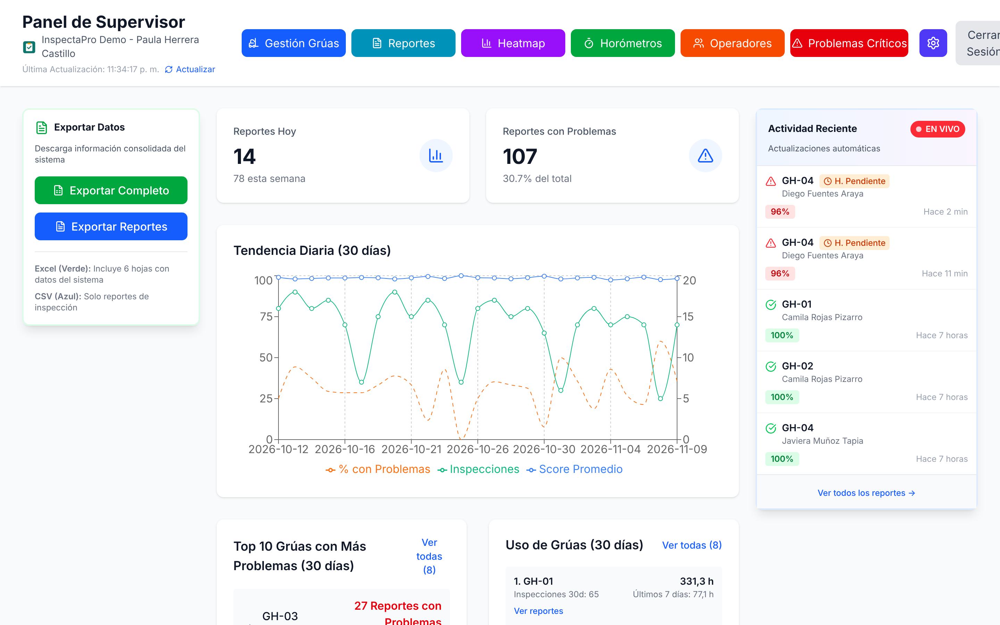
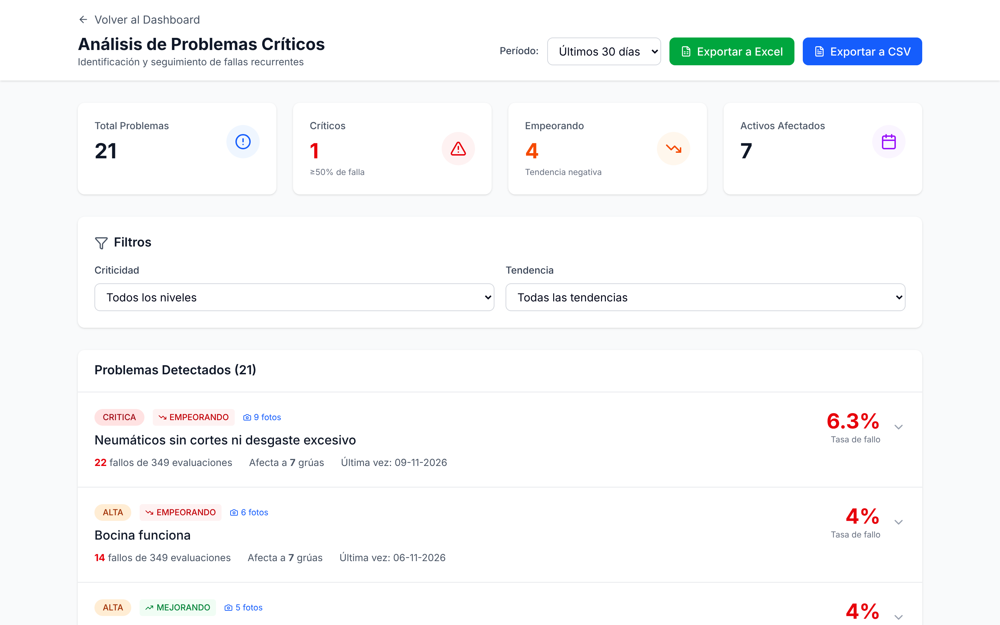
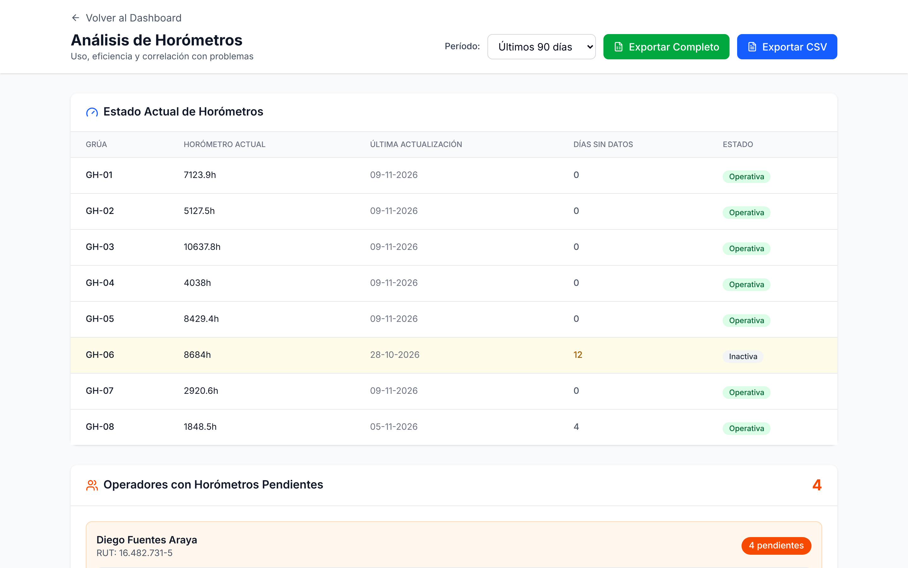
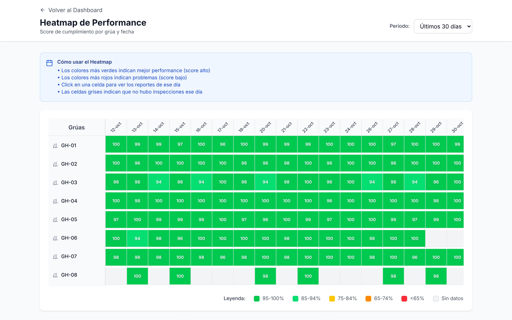
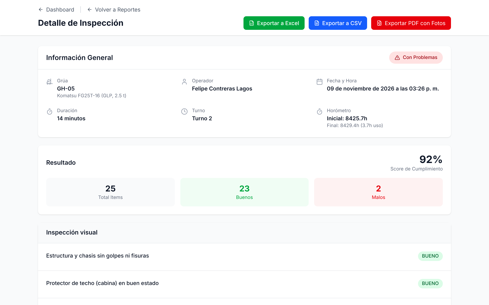

# InspectaPro – Demo · Panel web de inspecciones

**Panel web para supervisores** que convierte los checklists diarios de grúas horquilla, antes en papel y planillas Excel, en información en tiempo real: puntajes, fallas recurrentes, horómetros y reportes exportables.

> **Desarrollado como práctica profesional; esta es una versión demo con datos ficticios.**
> Empresas, personas, RUT, grúas y fotos de esta demo son inventados. La demo se reinicia automáticamente cada noche.

🔗 **Demo en vivo:** https://inspectapro-demo.vercel.app
📱 **App Android (APK demo):** https://github.com/andrynho10/inspectapro-app/releases/latest

| Rol | Usuario | Contraseña |
|---|---|---|
| Supervisor (panel web y app) | `supervisor.demo@example.com` | `Demo1234!` |
| Operador (solo app) | `operador.demo@example.com` | `Demo1234!` |



---

## El problema

En muchas bodegas y centros de distribución, el operador revisa su grúa horquilla al inicio de cada turno con un **checklist en papel**. Esas hojas terminan en una carpeta o se traspasan a mano a un Excel. Las consecuencias:

- El supervisor se entera de una falla (frenos, fuga hidráulica, neumáticos) **horas o días después**, si es que se entera.
- Nadie puede responder rápido cuál grúa falla más, qué falla se repite o si una tendencia va empeorando.
- Los horómetros se anotan incompletos y no se sabe cuántas horas reales trabaja cada equipo.
- No queda evidencia confiable (fotos, hora exacta, quién inspeccionó) ante una auditoría o un accidente.

## La solución

Un sistema de dos partes conectadas a la misma base de datos:

1. **App Android para operadores** ([inspectapro-app](https://github.com/andrynho10/inspectapro-app)): escanean el código QR de la grúa, completan el checklist con fotos de las fallas y registran el horómetro. **Funciona sin conexión** y sincroniza sola al recuperar señal.
2. **Este panel web para supervisores**: ve cada inspección **en el momento en que se envía**, analiza tendencias y exporta reportes en Excel, CSV o PDF.

## Funcionalidades del panel

- **Dashboard en vivo:** inspecciones de hoy, % con problemas, tendencia de 30 días, análisis por turno y feed "EN VIVO" que se actualiza sin recargar la página (Supabase Realtime).
- **Problemas críticos:** ranking de fallas con criticidad, tendencia (empeorando / mejorando / estable), grúas afectadas y fotos de evidencia.
- **Heatmap** de cumplimiento por grúa y día.
- **Horómetros:** estado por grúa, horas de uso, horas no registradas ("omitidas"), utilización y operadores con cierres pendientes.
- **Operadores y centros de costo:** inspecciones, puntaje promedio, duración y días desde la última inspección.
- **Gestión de grúas:** alta y edición de grúas, cambio de estado operativa / fuera de servicio con motivo e historial.
- **Reportes con filtros** (fecha, grúa, operador, turno, solo con problemas) y **detalle** de cada inspección con fotos.
- **Exportaciones:** Excel con varias hojas, CSV y **PDF del reporte con fotos**.
- **Configuración de notificaciones:** qué correos y supervisores reciben alertas de cada grúa.

| | |
|---|---|
|  |  |
|  |  |

## Stack

| Capa | Tecnología |
|---|---|
| Frontend | Next.js 15 (App Router), React 19, TypeScript, Tailwind CSS |
| Gráficos | Recharts |
| Exportación | SheetJS (Excel/CSV), jsPDF (PDF con fotos) |
| Backend | Supabase: PostgreSQL, Auth, Storage, Realtime |
| Lógica en BD | 27 funciones SQL (RPC), triggers y vistas |
| Seguridad | Row Level Security en todas las tablas |
| Hosting | Vercel (panel) · Supabase (base de datos) |

## Arquitectura y base de datos

```
App Android (Kotlin) ──┐                     ┌── Panel web (Next.js, Vercel)
  offline-first, Room  │                     │     Realtime + RPC
                       ▼                     ▼
              Supabase: PostgreSQL + Auth + Storage + Realtime
              14 tablas · 3 vistas · 27 funciones RPC · triggers · RLS
```

Las migraciones SQL completas están en [`supabase/migrations`](supabase/migrations):

- `01` tablas (grúas, plantillas de checklist, reportes, respuestas, fotos, horómetros, destinatarios)
- `02` triggers: el puntaje y las fallas se calculan **en la base de datos** al guardar las respuestas, junto con el turno y las horas de uso
- `03` vistas · `04` funciones de análisis (KPIs, tendencias, problemas críticos, horómetros)
- `05` **RLS**, bucket de fotos y Realtime · `06` datos ficticios y reinicio · `07` tareas programadas (pg_cron)

**Seguridad:** sin sesión no se puede leer nada. El operador solo crea y modifica sus propias inspecciones. El supervisor administra grúas y plantillas. El Security Advisor de Supabase no reporta problemas de RLS ni de funciones; la única advertencia, "Leaked password protection", corresponde a una opción exclusiva del plan pago.

## Qué es distinto en esta versión demo

| En el sistema original | En la demo |
|---|---|
| Correo con el reporte (Edge Function + Resend) y push a supervisores (Firebase) | **Simulado:** un trigger registra en la tabla `notificaciones_simuladas` a quién se habría avisado. No se envían correos ni push reales. |
| Datos reales de operación | Datos **ficticios** generados para 90 días (≈1.100 inspecciones), con fallas y tendencias realistas |
| Se pueden eliminar registros | **Eliminar está deshabilitado**, tanto en la interfaz como por RLS en el servidor |
| — | Cada noche (~04:00 Chile) los datos y las contraseñas demo se restablecen, y durante el horario laboral entra una inspección simulada por hora para que el panel "en vivo" muestre actividad |
| — | Registro público de usuarios deshabilitado |

## Correr localmente

```bash
git clone https://github.com/andrynho10/inspectapro-panel.git
cd inspectapro-panel
npm install
cp .env.example .env.local   # y completa con los datos de tu proyecto Supabase
npm run dev                  # http://localhost:3000
```

Para montar tu propia base de datos, crea un proyecto en Supabase y ejecuta los archivos de `supabase/migrations` en orden, desde el SQL Editor o con la CLI. Los archivos `06` y `07` son opcionales (datos demo).

## Autor

**Andrés Amaya Garcés**, Ingeniero de Ejecución en Informática (Chile).
Diseñé y desarrollé el sistema completo (app Android, panel web y base de datos) de forma individual durante mi práctica profesional (2025). Esta versión demo no contiene datos, marcas ni credenciales de la empresa donde se realizó la práctica.

¿Tu empresa todavía usa papel o Excel para inspecciones, checklists o registros en terreno? Este mismo enfoque se adapta a vehículos, maquinaria, aseo, mantención o control de calidad.
